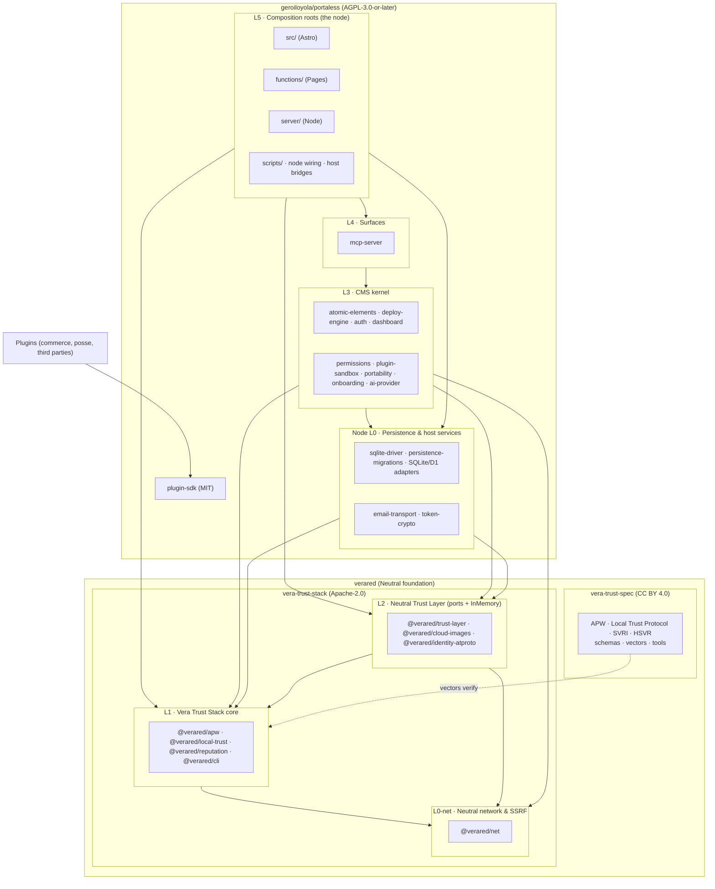

# ARCHITECTURE.md — Portaless as connected gears (`verared` vs `geroiloyola`)

> **Status:** owner-frozen governance and decoupling baseline (2026-11-24). It
> defines the **allowed dependency graph**, the **two-organization split**
> (`verared` foundation vs `geroiloyola` product), the **inventory of current
> violations**, the **Wave 1 / Wave 2 execution plan** and the **Export-Ready
> gate**. It is the documentation half of ROADMAP P2 **E-07** ("Package trust
> boundaries overlap and are not enforced"); the CI enforcement script is a
> separate PR.
>
> **This document moves no code, creates no repository, publishes no package and
> renames no frozen wire identifier, path, DID or signed artifact.** Every
> refactor and extraction PR needs its own written authorization (`AGENTS.md`
> convention 5).
>
> **Tie-break:** on *what exists today*, the code wins, then `ROADMAP.md`, then
> this file. On *licensing*, [`licensing-boundaries.md`](./docs/architecture/licensing-boundaries.md)
> wins. On *direction*, [`VISION.md`](./docs/VISION.md) wins. File/line
> references below are against `2eb7acb` and can be re-checked with `grep`.

---

## 1. Governance split: two GitHub accounts, one assembled node

Portaless is **one node assembled from independent gears**. The ecosystem is
split into two GitHub organizations with distinct roles so the trust standard
can be adopted worldwide without depending on any single CMS or vendor, while
Portaless inherits every gear cleanly:

| GitHub org / repo | Role | Packages / contents | Target license |
|---|---|---|---|
| `github.com/verared/vera-trust-spec` | Neutral foundation standard | `@verared/spec`: APW, Local Trust Protocol, SVRI, HSVR specs, schemas, conformance vectors and authoring tools (from `docs/protocol-apw/`) | **CC BY 4.0** |
| `github.com/verared/vera-trust-stack` | Neutral reference implementation (L0-net + L1 + L2) | `@verared/net`, `@verared/apw`, `@verared/local-trust`, `@verared/reputation`, `@verared/trust-layer`, `@verared/cloud-images`, `@verared/identity-atproto`, `@verared/cli` | **Apache-2.0** |
| `github.com/geroiloyola/portaless` | Reference sovereign node & CMS | Node L0 (`sqlite-driver`, `persistence-migrations`, `email-transport`, `token-crypto`), SQLite/D1 port adapters for `@verared/*`, L3 kernel, L4 (`mcp-server`), L5 composition roots (`src/`, `functions/`, `server/`, `scripts/`), canonical starter | **AGPL-3.0-or-later** |
| `github.com/geroiloyola/portaless-templates` | Demo / marketing & fictional templates (D11) | Demo profile, marketing EN/ES, eight fictional D8 use cases | Per-asset (PR-B1 gate) |
| `github.com/geroiloyola/portaless-plugin-sdk` *(optional extraction)* | Third-party plugin surface | `@portaless/plugin-sdk` | **MIT** |

**Unidirectional arrow:** `geroiloyola/*` consumes `verared/*` as pinned
external dependencies. `verared/*` has **zero** imports, runtime assumptions or
branding dependencies toward Portaless, Linstark, Cloudum or the owner's
personal account.



**The one rule:** a gear depends only on gears in a **lower layer** (or in
`verared/*` from `geroiloyola/*`), through their **public entry point**. Nothing
points upward; nothing reaches into another package's `src/` internals; only L5
wires concrete SQLite/D1 stores and runtime adapters together.

---

## 2. Licensing decision (frozen, 2026-11-24)

| Component | Target license | Current state in tree | Rationale |
|---|---|---|---|
| `verared/vera-trust-spec` (`docs/protocol-apw/`) | **CC BY 4.0** | Already `CC-BY-4.0` | Open standard; independent reimplementation creates no copyleft obligation. |
| `verared/vera-trust-stack` (L0-net, L1, L2 neutral) | **Apache-2.0** *(changed from `AGPL-3.0-or-later`)* | `Apache-2.0` in all 7 `verared`-bound `packages/*/package.json` + `LICENSE` (workspace names stay `@portaless/*` until Wave 2 export) | **Maximum worldwide adoption:** CDNs, browsers, proxies and proprietary CMSs can adopt `@verared/*` directly with an explicit patent grant. **100% compatible** with `geroiloyola/portaless` (`AGPL-3.0-or-later`). Transparency of the trust layer is guaranteed by the open specification and deterministic conformance vectors (any modified implementation that diverges fails verification), not by viral copyleft on the library. |
| `geroiloyola/portaless` (node L0, L3, L4, L5, SQLite/D1 adapters) | **AGPL-3.0-or-later** | `AGPL-3.0-or-later` | Protects the full CMS platform against closed-source SaaS forks. |
| `@portaless/plugin-sdk` | **MIT** | `MIT` (v0.1.0) | Clean legal boundary for third-party plugins. |

Verified third-party dependencies of L1/L2 (`canonicalize` Apache-2.0,
`web-bot-auth` Apache-2.0, `@noble/post-quantum` MIT; `better-sqlite3` MIT stays
in `geroiloyola/portaless`) have **zero license conflicts** with `Apache-2.0`.
See [`docs/architecture/licensing-boundaries.md`](./docs/architecture/licensing-boundaries.md)
for the legal boundary text.

---

## 3. Live nomenclature vs frozen wire bytes (frozen, 2026-11-24)

To eliminate collision with *Linux Test Project* (and RFC 5326) and remove
product branding from the neutral standard, **live prose** and **frozen wire
bytes** are strictly separated:

| Concept | Live prose in `verared` (neutral) | Live prose in `portaless` (product) | Frozen Level A / historical (DO NOT RENAME) |
|---|---|---|---|
| Trust protocol | **Local Trust Protocol** (no standalone `LTP` acronym in live prose) | **Local Trust Protocol** | `ltp-svri-site-v1`, `ltp-svri-reader-v1`, `ltp-site-log-proof-v1`, `ltp-reader-conduct-proof-v1`, `urn:ltp:schemas:0.1:*`, `vectors/ltp/**` |
| Complete trust stack | **Vera Trust Stack** (APW + Local Trust Protocol + SVRI + HSVR) | **Vera Trust Stack** | `APW`, `SVRI`, `HSVR`, `did:apw`, `_apw.`, `pAPW`, `apw-*+jws`, `apw-identity-proof-v1`, `svri-projection-v1`, `W-01..W-09`, `R-01..R-05`, `T1..T5`, `E-10..E-16` |
| Witness aggregator | **Witness Index** | **Portaless Index** (only for Portaless's reference implementation and reference appendices) | `/.well-known/apw-index.json` |
| Target network / foundation | **Verared** (unifies live mentions of `Veranet`) | **Verared** | *"Veranet Universal Scoring System"* in Annex A (historical attribution to Gerardo Loyola) |
| Community evaluator role | **`community attester`** (IETF/W3C clarity) | **`Veracier`** (Portaless UX, brand and `/trust/veracier/:domain`) | Historical errata/records |

### Unbreakable guardrails (never touch during Wave 1)

- **Level A wire identifiers:** `did:apw`, `_apw.`, `pAPW`, `apw-*+jws`,
  `ltp-svri-site-v1`, `apw-identity-proof-v1`, `ltp-site-log-proof-v1`,
  `ltp-reader-conduct-proof-v1`, `ltp-svri-reader-v1`, `svri-projection-v1`,
  `urn:ltp:schemas:0.1:*`, `W-01..W-09`, `R-01..R-05`, `T1..T5`, `E-10..E-16`.
- **Approved digests and anchors:** all JSON files in `docs/protocol-apw/vectors/`
  (G1 corpus digest `wNQ9gG2BPs8JO1wPsiPgoz265juDT-TCjuGMbTzSYXA`), all files
  pinned by SHA-256 in `docs/protocol-apw/LTP-APPROVAL-RECORD.md`, and the
  legacy section-6 anchor `#6-reputation-based-read-governance--loyal-trust-protocol-v12--e-8-e-9`.
- **Out of scope for Wave 1:** existing tables in `schema.sql`, the active
  PR-B1 (#115) / PR-B2 (`portaless-templates`) queue, and runtime activation of
  G4/G5 (still governed by [`LTP-GATES-AND-AUTHORIZATIONS.md`](https://github.com/verared/vera-trust-spec/blob/v0.1.0-draft.1/spec/LTP-GATES-AND-AUTHORIZATIONS.md)).

---

## 4. Layer assignment and current violations (`2eb7acb`)

### 4.1 Target layers

| Layer | Destination | Packages / modules | May depend on | Must not |
|---|---|---|---|---|
| **Contracts** | `verared` / `geroiloyola` | `docs/protocol-apw/` (`@verared/spec`), `packages/plugin-sdk/` (MIT) | Nothing in Portaless | Import any runtime code |
| **L0-net (neutral)** | `verared` (`@verared/net`) | `packages/net` (new): `safe-fetch`, SSRF/DNS-rebinding guards from `ltp-engine/src/ssrf.ts`, egress budgets, neutral client-IP trust helper | Web/Node platform | Know about SQLite, D1, pages, users or Portaless headers |
| **L1 Stack core** | `verared` | `apw-resolver` (pure core → `@verared/apw`), `ltp-engine` (`@verared/local-trust`), `ltp-reputation` (`@verared/reputation`), future `@verared/cli` | L0-net, Contracts (vectors in tests) | Import `sqlite-driver`, `trust-layer`, or any CMS package |
| **L2 Neutral Trust Layer** | `verared` | Pure core + ports + `InMemory*` stores of `trust-layer` (`@verared/trust-layer`), `cloud-images` (`@verared/cloud-images`), `identity-atproto` (`@verared/identity-atproto`) | L1, L0-net | Import `sqlite-driver`, `dashboard`, `permissions`, `deploy-engine` or `x-portaless-*` headers |
| **Node L0** | `geroiloyola` | `sqlite-driver`, `persistence-migrations`, `email-transport`, `token-crypto`, and the SQLite/D1 port adapters for L1/L2 | L2, L1, L0-net | Leak back into `verared` |
| **L3 CMS kernel** | `geroiloyola` | `atomic-elements`, `deploy-engine`, `auth`, `dashboard`, `permissions`, `plugin-sandbox`, `portability`, `onboarding`, `ai-provider` | L2, L1, L0-net, Node L0, `plugin-sdk` | Form cycles; sandbox must receive CMS stores via ports |
| **L4 Surfaces** | `geroiloyola` | `mcp-server` | L3, L2, Node L0 | Reach into `src/` internals |
| **L5 Composition roots** | `geroiloyola` | `src/`, `functions/`, `server/`, `scripts/`, `activation-service.ts`, `unsigned-bot-metrics.ts`, plugin host bridges | Public entry points only | Hold reusable protocol/trust math |
| **Extensions** | `geroiloyola` / third parties | `commerce-plugin`, `posse-syndicator-plugin`, third-party plugins | `plugin-sdk` only | Import any other `packages/*` |

### 4.2 Measured violations today (non-test source scan on `2eb7acb`)

**181 cross-package imports** are deep relative paths into another package's
`src/`; only **1** (`packages/dashboard/src/security/role-guard.ts:1` →
`@portaless/auth`) uses a package name.

#### Cycles (must be broken first)

| Cycle | Evidence | Fix in Wave 1 |
|---|---|---|
| `apw-resolver` ⇄ `trust-layer` | `apw-resolver/src/scoring/reader-attestations.ts:29` → `trust-layer/src/site-trust/attestation`; `reader-conduct-auto.ts:24`, `reader-conduct-emitter.ts:19` → `trust-layer/src/ledger/*`; reverse: `trust-layer/src/{webbotauth/verify.ts:51,webbotauth/directory-fetch.ts:1,net/resolution-budget.ts:1}` → `apw-resolver/src/federation/safe-fetch` | (1) Move `safe-fetch` + `ltp-engine/src/ssrf.ts` + egress budget + client-IP helper to `packages/net` (re-exported by `apw-resolver` for compatibility). (2) Move pure attestation verification into L1. (3) Move runtime `reader_conduct` ledger glue to L2 (or inject a minimal `UsageSource` port). |
| `permissions` ⇄ `plugin-sandbox` | `permissions/src/permission-center-ui.ts:35` → `plugin-sandbox/src/capabilities/capability-registry`; `plugin-sandbox/src/runtime/production-plugin-runner.ts:44-45` → `permissions/src/*` | Single capability vocabulary consumed by both (proposal: `plugin-sdk` catalog, already parity-tested; confirm in that PR). |

#### Reverse and boundary violations blocking `verared` extraction

| Violation | Count & evidence | Fix in Wave 1 |
|---|---|---|
| L1/L2 → `sqlite-driver/src/open` | **14 imports**: `apw-resolver` (3: `did-apw/atproto-links-store.ts`, `did-apw/store-factory.ts`, `scoring/read-policy-store.ts`), `trust-layer` (10: `billing/pay-per-crawl/activation-store.ts`, `ledger/sqlite-log-store.ts`, `ledger/unsigned-bot-metrics.ts`, `net/resolution-budget-config.ts`, `policy/agent-access-store.ts`, `site-trust/{authorized-agents,authorized-escrow-providers,community-attestations,stores/sqlite-site-trust-store}.ts`, `webbotauth/nonce-store.ts`), `cloud-images` (1: `store.ts`) | Define pure storage ports + `InMemory*` stores inside the `verared`-bound packages; move all `Sqlite*` and `D1*` implementations to Portaless Node L0. |
| L2 → L3 (`trust-layer` → CMS) | **3 imports**: `billing/pay-per-crawl/activation-service.ts:9-10` → `deploy-engine/src/token-crypto` & `permissions/src/permission-store`; `ledger/unsigned-bot-metrics.ts:1` → `dashboard/src/site-settings/site-settings-store` | Move `activation-service.ts` and `unsigned-bot-metrics.ts` to Portaless L5/Node L0 (they are Portaless node wiring, not neutral Trust Layer). |
| L3 sideways & sandbox coupling | `atomic-elements` → `deploy-engine/src/draft-filter` (4); `plugin-sandbox/src/capabilities/capability-backends.ts:25-33` → `atomic-elements`, `dashboard`, `trust-layer`, `deploy-engine`, `email-transport` | Move `draft-filter` into `atomic-elements`; inject sandbox capability backends via ports from L5. |
| Extension → core internals | `commerce-plugin/src/host-bridge.ts`, `posse-syndicator-plugin/src/host-bridge.ts` → `permissions`, `plugin-sandbox` | Move host bridges to L5 so plugin packages import `plugin-sdk` only. |
| L4 & L2 deep `src/` imports | `mcp-server` (94), `cloud-images` (8 to `apw-resolver`, 1 to `trust-layer`), `identity-atproto` (6 to `apw-resolver`, 1 to `trust-layer`) | Add `exports` maps to every package and migrate all 181 deep imports to public entry points. |

**Already clean (0 cross-package imports):** `plugin-sdk`, `ltp-engine`,
`ltp-reputation`, `ai-provider`, `portability`, `email-transport`,
`sqlite-driver`, `docs/protocol-apw`.

---

## 5. Trust Layer scope: any entity

The neutral Trust Layer (`@verared/trust-layer`) is not a CMS feature; its
subject is any entity with verifiable cryptographic identity: sites, AI agents,
organizations, plugin authors and, as a `GATED` direction, **human ↔ human**
trust evaluation. Any future human-subject profile must preserve `VISION.md`
rules (local policy only, no global rankings, evidence before score,
proportionate identity) and pass the specification gate register before code.

---

## 6. Two-Wave execution plan (`Tanda 1` → `Tanda 2`)

> **Current operational constraint:** only `github.com/geroiloyola` is connected
> right now. No external `verared` repository is created or pushed during Wave 1.

### Wave 1 — Internal decoupling inside `geroiloyola/portaless`

Each step is a separate, small, authorized PR that keeps all four repo checks
green (Vitest, Astro build, manifest validation, Playwright) with zero new
`skip`s and zero wire-format changes:

| Order | PR scope | Closes / advances |
|---|---|---|
| **W1.0** *(PR #116)* | Governance baseline: `ARCHITECTURE.md` + `docs/architecture/licensing-boundaries.md` (two-org split, `Apache-2.0` decision, live nomenclature rules, Wave 1/Wave 2 plan, Export-Ready gate) | ✅ Documentation half of **E-07** |
| **W1.1** *(PR #117)* | CI import-boundary checker in **report mode** (lists all deep imports, cycles and layer violations without failing CI yet) | ✅ Starts **E-07** enforcement |
| **W1.2** *(PR #118)* | Create `packages/net` (future `@verared/net`): unify `safe-fetch`, `ltp-engine/src/ssrf.ts`, egress budgets and neutral client-IP trust helper; re-export from `apw-resolver` for compatibility | ✅ Closes **E-06**; breaks L2 → L1 half of cycle 1 |
| **W1.3** *(PR #119)* | Break cycles: move attestation verification to L1, move runtime `reader_conduct` ledger glue to L2 (cycle 1 closed); unify capability vocabulary between `permissions` and `plugin-sandbox` (cycle 2 closed) | ✅ **0 cycles** across the monorepo |
| **W1.4** *(PR #120)* | Extract L1/L2 storage ports + `InMemory*` stores; move all 14 `Sqlite*`/`D1*` stores plus `activation-service.ts` and `unsigned-bot-metrics.ts` into Portaless Node L0/L5 | ✅ **0 imports** from `verared`-bound packages to `sqlite-driver` or L3 |
| **W1.5** *(PR #121)* | CMS internal hygiene: move `draft-filter` to `atomic-elements`, inject `plugin-sandbox` capability backends via ports, move plugin `host-bridge.ts` files to L5 | ✅ **0 layer/org violations** across the monorepo |
| **W1.6a / W1.6b** *(PR #122, PR #123)* | Add strict `exports` maps to all `verared` and `geroiloyola` packages and migrate all deep `src/` imports to public package entry points | ✅ **0 deep `src/` imports** across `packages/*` and L5 |
| **W1.7** *(PR #124)* | Live nomenclature & spec sanitization (`Local Trust Protocol`, `Vera Trust Stack`, `Witness Index`, `Verared`, `community attester`) + `Apache-2.0` license alignment on the 7 `verared` packages without touching Level A bytes, `vectors/` or `LTP-APPROVAL-RECORD.md` hashes | ✅ Neutral `verared` prose & `Apache-2.0` licensing ready |
| **W1.8** *(this PR)* | Switch CI import-boundary checker to **blocking (`--strict`) mode** with org-license lock in CI and `verify-release.mjs` | ✅ Closes **E-07**; satisfies **Export-Ready (Wave 1 → Wave 2)** gate |

### Export-Ready Checklist (Gate: Wave 1 → Wave 2)

Wave 2 **must not start** until every item below is verified true in CI on
`geroiloyola/portaless`:

- [x] **Zero reverse imports:** `packages/{net,apw-resolver,ltp-engine,ltp-reputation,trust-layer,cloud-images,identity-atproto}` have **0** imports to `sqlite-driver`, `persistence-migrations`, `email-transport`, `dashboard`, `permissions`, `deploy-engine`, `atomic-elements`, `auth`, `plugin-sandbox`, `src/`, `functions/` or `server/`.
- [x] **Zero cycles:** the entire workspace dependency graph is a DAG.
- [x] **Zero deep `src/` imports:** all cross-package and L5 `../.../src/...` imports are replaced by declared `exports` entry points.
- [x] **CI boundary enforcement active:** `scripts/check-architecture-boundaries.mjs --strict` runs in **blocking mode** in CI and `scripts/verify-release.mjs`, including automatic per-org license verification (`E-07` closed — W1.8).
- [x] **Spec neutrality verified:** live unpinned `docs/protocol-apw/` prose uses neutral terms (`Witness Index`, `community attester`, `Local Trust Protocol`, `Vera Trust Stack`, `Verared`), and all `LTP-APPROVAL-RECORD.md` / G1 vector digests remain byte-identical.
- [x] **Full verification green on Node 24:** Vitest, Astro build, manifest validation, Playwright browser suite, and `docs/protocol-apw` standalone test/audit suite all pass with zero added skips.
- [x] **License metadata aligned:** `licensing-boundaries.md` and the 7 `verared`-bound packages reflect `CC BY 4.0` (spec) and `Apache-2.0` (stack).

### Wave 2 — Export to `github.com/verared/*` (**100% completed**)

1. ✅ **W2.1:** Created `github.com/verared/vera-trust-spec` (`CC BY 4.0`, `@verared/spec` `v0.1.0-draft.1`, commit `7787966`) from `docs/protocol-apw/` with immutable release tarball + `SHA256SUMS` and Node 24 cryptographic CI (`18/18` SHA-256 + `5/5` JCS digests).
2. ✅ **W2.2:** Created `github.com/verared/vera-trust-stack` (`Apache-2.0`, `v0.1.0-alpha.1`, commit `d2e1d4a`) containing `@verared/{net,apw,local-trust,reputation,trust-layer,cloud-images,identity-atproto}` compiled to `dist/` (`ESM .js` + `.d.ts`), pinned via `SPEC-PIN.json` and distributed as immutable GitHub Release tarballs.
3. ✅ **W2.3 *(PR #126)*:** Updated `geroiloyola/portaless` to consume the exact pinned `@verared/*` `v0.1.0-alpha.1` tarballs (via `dependencies` + `overrides` + `.npmrc` `allow-remote=root`) and `SPEC-PIN.json`, and deleted the 7 migrated local `packages/*` copies.
4. ✅ **W2.3b *(PR #127)*:** Retired the duplicated local `docs/protocol-apw/` specification tree (leaving only the minimal redirect [`docs/protocol-apw/README.md`](./docs/protocol-apw/README.md)), pinned `@verared/spec` `v0.1.0-draft.1` tarball in `devDependencies` for Astro reference docs and vector tests, and enforced zero local spec duplication in `scripts/check-architecture-boundaries.mjs --strict`.

### Wave 3 — Decoupling within `github.com/geroiloyola/*` (**100% completed**)

1. ✅ **W3.1:** Created standalone MIT repository `github.com/geroiloyola/portaless-plugin-sdk` (`@portaless/plugin-sdk` `v0.1.0`, commit `4b074fd`), compiled to `dist/` (`ESM .js` + `.d.ts`) with strict `.` export, Node 24 CI (`ci.yml` + automated `release.yml`), and published immutable GitHub Release tarball `portaless-plugin-sdk-0.1.0.tgz` + `SHA256SUMS`.
2. ✅ **W3.2 *(PR #128)*:** Updated `geroiloyola/portaless` to consume `@portaless/plugin-sdk` `v0.1.0` via GitHub Release tarball (`dependencies` + `overrides`), migrated `permission-center-ui.ts` and contract tests off `./source`, removed local `packages/plugin-sdk/` and `.github/workflows/plugin-sdk-conformance.yml`, and enforced zero local SDK duplication in `scripts/check-architecture-boundaries.mjs --strict`.
3. ✅ **W3.3 *(PR #129, PR-B2)*:** Split site content into autonomous physical profiles (`starter` default vs `demo`), unified `PORTALESS_SITE_PROFILE=starter|demo` in `src/lib/site-profile.mjs`, gated demo-only Astro routes before generation via `injectRoute`, sanitized Class D personal data (`creator-demo.json` + `/avatars/creator-demo.svg`), replaced all unverified external images/embeds/forms with 21 original local SVGs documented in `ASSETS-LICENSES.md`, and validated both profiles in CI.
4. ✅ **W3.4:** Created standalone `CC0-1.0` repository `github.com/geroiloyola/portaless-templates` (`@portaless/templates` `v0.1.0`, commit `5eb6d6a`) with Node 24 CI (`verify-templates.mjs` + `smoke-tarball.mjs`) and automated `release.yml`, publishing immutable `portaless-templates-0.1.0.tgz` + `SHA256SUMS`.
5. ✅ **W3.5 *(this PR)*:** Retired local `site-profiles/demo/` from `geroiloyola/portaless` (leaving `site-profiles/starter/` as the sole local canonical profile), pinned `@portaless/templates` `v0.1.0` via GitHub Release tarball (`devDependencies` + `overrides`), switched `PORTALESS_SITE_PROFILE=demo` to resolve from `node_modules/@portaless/templates/demo/`, and enforced zero local demo duplication in `scripts/check-architecture-boundaries.mjs --strict`.

#### Final 5-repository ecosystem (Waves 1–3 complete)
- `github.com/verared/vera-trust-spec` (`@verared/spec` `v0.1.0-draft.1`, **CC BY 4.0**)
- `github.com/verared/vera-trust-stack` (`@verared/*` `0.1.0` on `registry.npmjs.org`, **Apache-2.0**)
- `github.com/geroiloyola/portaless-plugin-sdk` (`@portaless/plugin-sdk` `v0.1.0`, **MIT**)
- `github.com/geroiloyola/portaless-templates` (`@portaless/templates` `v0.1.0`, **CC0-1.0**, per-asset verified)
- `github.com/geroiloyola/portaless` (**AGPL-3.0-or-later**, clean `starter` default, consumes all four external gears via immutable GitHub Release tarballs with zero tokens)

---

## 7. Target repository layouts (after Wave 2)

### 7.1 `github.com/verared/vera-trust-spec` (`CC BY 4.0`)

```text
vera-trust-spec/
├── README.md · LICENSE (CC BY 4.0) · GOVERNANCE.md · ERRATA.md · CHANGELOG.md
├── apw/           # APW-SPEC-v1.3 (+ archived v1.0, v1.2), bootstrap draft
├── local-trust/   # Local Trust Protocol core contracts, profiles, identifier registry
├── svri/          # SVRI-v1.0 profile
├── hsvr/          # HSVR history contract
├── schemas/       # versioned JSON schemas (v0.1 preserved intact) + manifest
├── vectors/       # immutable APW / SVRI / Local Trust corpora + digests
├── tools/         # standalone authoring & cross-check tools (own lockfile)
└── conformance/   # results with real implementer / reviewer identities
```

### 7.2 `github.com/verared/vera-trust-stack` (`Apache-2.0`)

```text
vera-trust-stack/
├── README.md · LICENSE (Apache-2.0) · SPEC-PIN.json
├── packages/
│   ├── net/               # @verared/net (safe-fetch, SSRF/DNS-rebinding, egress budgets, client-IP helper)
│   ├── apw/               # @verared/apw (did:apw, JWS/JCS, history, witnesses, Witness Index, SVRI math)
│   ├── local-trust/       # @verared/local-trust (bounded acquisition + offline verifier)
│   ├── reputation/        # @verared/reputation (deterministic static decision-case engine)
│   ├── trust-layer/       # @verared/trust-layer (Web Bot Auth, policy, SiteTrustScore, ledger ports + InMemory)
│   ├── cloud-images/      # @verared/cloud-images (signed PNG pAPW sidecars + remote verifier)
│   ├── identity-atproto/  # @verared/identity-atproto (AT Protocol handle/DID bridge)
│   └── cli/               # @verared/cli (verify did | jws | image)
├── adapters/
│   ├── cloudflare-worker/ # standalone edge middleware for any site
│   └── node-middleware/   # standalone Node middleware for any site
└── conformance/           # runs pinned vera-trust-spec vectors in CI
```

### 7.3 `github.com/geroiloyola/portaless` (`AGPL-3.0-or-later`)

```text
portaless/
├── ARCHITECTURE.md · AGENTS.md · AGENT.md · ROADMAP.md · CHANGELOG.md
├── src/                   # L5 Astro site
├── functions/             # L5 Cloudflare Pages composition root (incl. activation-service, unsigned-bot-metrics)
├── server/                # L5 Node self-host composition root
├── scripts/               # L5 setup, publish, backup, CI boundary check
├── site-profiles/         # starter (demo moves to portaless-templates after PR-B2)
├── packages/
│   ├── sqlite-driver/ · persistence-migrations/ · email-transport/ · trust-storage-adapters/
│   ├── atomic-elements/ · deploy-engine/ · auth/ · dashboard/ · permissions/ · plugin-sandbox/
│   ├── portability/ · onboarding/ · ai-provider/ · mcp-server/
│   └── plugin-sdk/        # MIT (optional extraction → geroiloyola/portaless-plugin-sdk)
├── plugins/               # first-party plugins (commerce, posse; SDK-only imports)
└── tests/                 # unit · e2e · browser · boundary
```

### 7.4 `github.com/geroiloyola/portaless-templates` (D11)

```text
portaless-templates/
├── README.md · ASSETS-LICENSES.md   # per-asset author/license evidence (PR-B1 gate)
├── demo/            # marketing EN/ES + the eight fictional D8 use cases
├── templates/       # fictional layouts usable by the wizard
└── public/          # demo-only assets (original art, no real people)
```

The wizard generator (`packages/onboarding/`) and its programmatic templates
remain in `geroiloyola/portaless` (D9).
