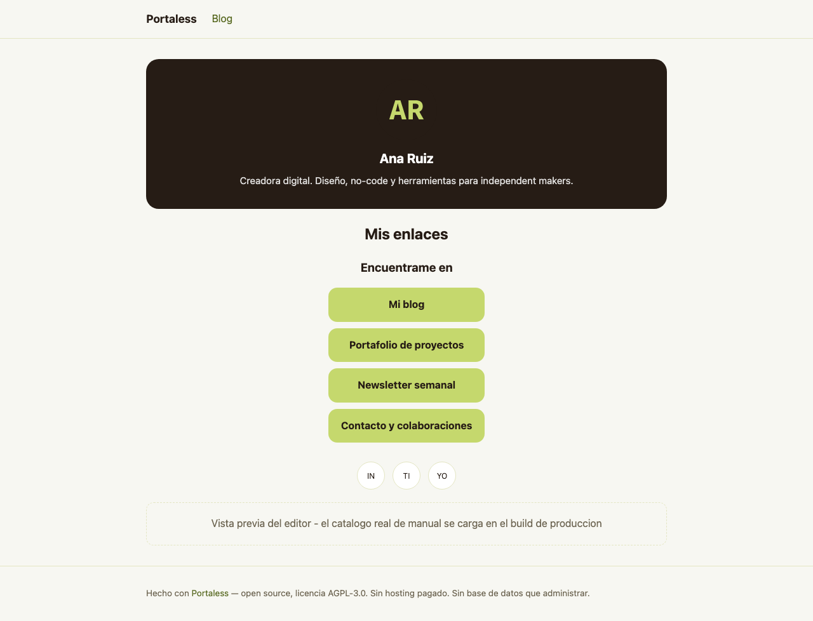
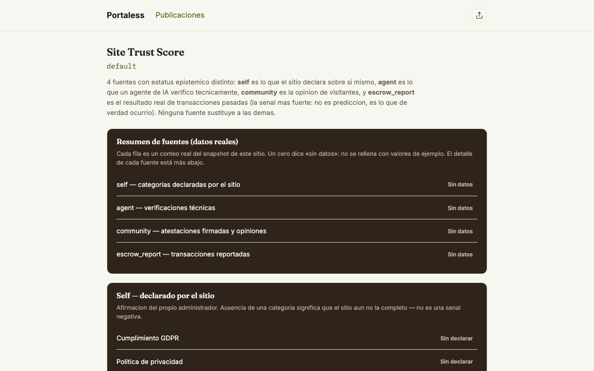

<div align="center">

# Portaless

**Less Portals, More Simplicity**

A lightweight, open source, modular CMS — built to be published without paid hosting, without plugins that break your site, and with real control over which AI agents can access your content.

[](./LICENSE)
[](./ROADMAP.md)
[](https://astro.build)
[](./docs/protocol-apw/APW-SPEC-v1.3.md)

[Roadmap](./ROADMAP.md) · [Live demo](https://geroiloyola.github.io/portaless/) · [Protocol APW](./docs/protocol-apw/APW-SPEC-v1.3.md) · [API guide](./docs/api/README.md) · [Docs index](./docs/README.md) · [Whitepaper](./docs/whitepaper/portaless-whitepaper.md) · [Security](./SECURITY.md) · [Licensing](./docs/architecture/licensing-boundaries.md) · [Contributing](./CONTRIBUTING.md)

</div>

---

## What is Portaless?

Portaless is a CMS built on [Astro](https://astro.build) that solves, by architectural design, the most persistent structural problems of WordPress:

- **No exposed database, no server to manage** — the site compiles to static HTML and is served from free infrastructure (GitHub Pages, Cloudflare Pages).
- **Sandboxed plugins with atomic permissions**, instead of unrestricted access to the core (the root cause of 96% of WordPress's historical vulnerabilities).
- **Granular control over AI agents**: cryptographic bot identification, pay-per-crawl policies, and a public traceability ledger.
- **A native visual editor (Atomic Elements)**, designed to be radically lighter than Elementor.
- **A modular dashboard with swappable "skins"**, no CSS or PHP required.
- **Real account protection**: two-factor authentication, password recovery, and login via external providers (Google, GitHub, etc.).
- **Cross-site trust and discovery** via Protocol APW and a public `SiteTrustScore`, so independent Portaless instances can verify each other without any central authority.

> **Current status: alpha / MVP.** Not everything described in the whitepaper is implemented yet. Before using this in production, read the [Real status by module](#real-status-by-module) section and [`ROADMAP.md`](./ROADMAP.md).

---

## See Portaless in action

**Live demo (no install needed): [geroiloyola.github.io/portaless](https://geroiloyola.github.io/portaless/)** — the public site deployed from this repo on every push to `main`. GitHub Pages runs no `functions/`, so the demo shows the static site only (home, blog, example pages); admin, login, and the dynamic `/trust/:siteId` need [self-host or Cloudflare Pages](#deployment).

Real screenshots of the running product — captured from the live app, not mockups. Regenerate them anytime with `npm run build && node node_modules/tsx/dist/cli.mjs scripts/capture-screenshots.mjs` (output in [`docs/screenshots/`](./docs/screenshots)).

| The public site: a link-in-bio page built by dragging Atomic Elements | The visual editor: palette, live canvas, properties |
|---|---|
| [](docs/screenshots/public-link-in-bio.png) | [](docs/screenshots/editor-atomic-elements.png) |

| The admin dashboard | SiteTrustScore — public, per site, 4 sources |
|---|---|
| [](docs/screenshots/admin-dashboard.png) | [](docs/screenshots/trust-score.png) |

**The whole edit → publish cycle in one take**: drag an element into the canvas, click *Publicar*, open the public URL — no terminal, no rebuild (self-host / Cloudflare Pages):


---

## Table of contents

- [See Portaless in action](#see-portaless-in-action)
- [Features](#features)
- [Recent updates](#recent-updates)
- [Real status by module](#real-status-by-module)
- [Installation](#installation)
  - [macOS](#macos)
  - [Linux](#linux)
  - [Windows](#windows)
- [Getting started](#getting-started)
- [Configuration](#configuration)
- [Project structure](#project-structure)
- [Deployment](#deployment)
- [Authentication](#authentication)
- [Licensing](#licensing)
- [Roadmap](#roadmap)
- [Security](#security)
- [Contributing](#contributing)
- [License](#license)

---

## Features

| Module | What it does |
|---|---|
| **Content engine** | Astro + Markdown, 100% static site, no mandatory server runtime |
| **Atomic Elements** | Drag-and-drop visual page editor, without Elementor's DOM depth or page weight — 17 elements (Hero, columns, media, Video, FAQ, Testimonial, contact Form, Gallery…) including 4 for sovereign link-in-bio pages (`ProfileHeader`, `LinkList`, `SocialIcons`, `StoreBlock`) |
| **Dashboard + Skin System** | Modular admin panel: each "skin" rearranges the same components via a JSON file, no code required |
| **Commerce (Medusa/Mercur)** | Optional module that consumes an external store's catalog — never reimplements checkout or payments |
| **Trust Layer** | AI agent identification (Web Bot Auth, RFC 9421/Ed25519, same draft-03 header rules as Cloudflare), access policies (`allow`/`charge`/`block`), a publicly queryable traceability ledger, and pay-per-crawl through pluggable settlement providers (`cloudflare-pay-per-crawl` today) — Portaless never touches the money |
| **AI discovery** | `/llms.txt` (llmstxt.org v2), a markdown version of every post (`/blog/<id>.md`), a single `robots.txt` generated by the Trust Layer with Content Signals, and a complete `sitemap.xml` — drafts are never published |
| **SiteTrustScore** | Public, multi-source trust score per site (`self`, `agent`, `community`, `escrow_report`), with admin UI to grant/revoke authorized agents and escrow providers without touching a terminal |
| **Protocol APW** | Cross-site discovery via DNS TXT record (`_apw.yourdomain.com`), resolved over DNS-over-HTTPS, with a manifest (`siteId`, `trustUrl`, `contentKinds`) and a CLI to publish it |
| **MCP server** | Native Model Context Protocol server — an AI agent can create/update pages, query the usage ledger, list installed plugins, and manage permissions directly |
| **Plugin Sandbox** | Multi-provider plugin isolation (Cloudflare, Deno Deploy, Fastly, or self-hosted via `isolated-vm`), with all 12 plugin capabilities from the catalog wired to real code |
| **Permissions Center** | Atomic per-plugin/per-agent capability control, like the iOS/Android Privacy screen — connected to real persistence, with a community-driven `trustScore` badge per plugin. Pay-per-crawl providers appear here too, but can only be activated from `/admin/settlement` with verified credentials |
| **Authentication** | Username/password login with roles (`admin`/`viewer`), two-factor authentication, password recovery, and login via external providers (OAuth/SSO) |
| **Self-hosting** | Node runtime that runs the same `functions/` as Cloudflare Pages, Docker image, Docker Compose, Railway and Render configs, and a first-run `/setup` screen to create the admin without a terminal |

## Recent updates

The "what shipped in each release" narrative deliberately does not live in this README anymore. It is split, like the roadmap:

- [`CHANGELOG.md`](./CHANGELOG.md) — what was added, fixed or pending in each version.
- [`docs/roadmap/ROADMAP-ARCHIVE.md`](./docs/roadmap/ROADMAP-ARCHIVE.md) — the immutable roadmap log (PRs #1–#75, refactor registers, closed entries with their full session context).

For what is true **today**, read [Real status by module](#real-status-by-module) below and [`ROADMAP.md`](./ROADMAP.md) — both describe only the current state.

## Real status by module

This project explicitly documents what's implemented versus what's a pending skeleton. Don't assume functionality from a folder name — check [`AGENT.md`](./AGENT.md) and [`ROADMAP.md`](./ROADMAP.md) for the live detail. Summary:

| Module | Status |
|---|---|
| Content engine, commerce (read), Atomic Elements, Dashboard | ✅ Functional |
| Authentication (login + D1/SQLite persistence + 2FA + password recovery + OAuth/SSO) | ✅ Functional, with persistent MFA challenges (5-attempt limit) and rate-limited password reset — see pending integration note in [`docs/architecture/authentication.md`](./docs/architecture/authentication.md) |
| Permissions Center | ✅ UI connected to real persistence (D1/SQLite) via `functions/admin/permissions/index.js`, with server-side guard `canWrite(role)` — plugin catalog now backed by a real dynamic registry with community `trustScore`, see [`PERMISSIONS_CENTER.md`](./packages/permissions/docs/PERMISSIONS_CENTER.md). Billing grants (`billing:*`) are rejected by the generic endpoint and only written by `/admin/settlement` |
| Trust Layer (policies + ledger) | ✅ Write path connected since v0.0.6, public read path connected in v0.0.9.3 via `GET /.well-known/portaless-usage-log.json` — see [`TRUST_LAYER_SETUP.md`](./packages/trust-layer/docs/TRUST_LAYER_SETUP.md). The middleware applies your published policy (Cloudflare Pages and self-hosted Node) and lets discovery routes (`robots.txt`, `llms.txt`, `sitemap.xml`, `/.well-known/*`, `/blog/*.md`) through without a signature |
| Pay-per-crawl (`cloudflare-pay-per-crawl`) | 🟡 Implemented: in-band `crawler-price` behind Cloudflare, activation only with a verified Cloudflare API token (Zone Read) + admin password/2FA + APW site identity. Pending: test against a live Cloudflare zone with Pay Per Crawl enabled (today only mocked tests) and confirm the minimum price (assumed USD 0.01). The `settlement_provider_activations` table is in the master `schema.sql` and `REQUIRED_TABLES` since v0.0.9.10 (stores still create it on the fly for pre-existing databases). Without an active provider, `charge` responds `402` with `settlement: "not_available"` and nothing is charged |
| AI discovery (`llms.txt`, markdown per post, `robots.txt`, sitemap) | ✅ Generated at build time from your content and AI policy. Limitation: pages stored only in D1/SQLite are not included in `llms.txt` |
| SiteTrustScore (4 sources: self, agent, community, escrow_report) | ✅ All 4 sources have a connected HTTP endpoint; `agent` and `escrow_report` have a full admin lifecycle (grant/revoke UI, no manual API calls needed). Pending: both allowlists are empty by default, and there's no automated onboarding flow for a second escrow provider yet |
| Protocol APW (cross-site identity, trust and discovery) | ✅ Full implementation of the normative spec v1.3 ([`APW-SPEC-v1.3.md`](./docs/protocol-apw/APW-SPEC-v1.3.md)): DNS-over-HTTPS resolution of the `_apw.` TXT record (manifest v2 with `k`/`h`/`rg`), `did:apw` identity with key rotation and public `did.json`, signed site artifacts (JWS + JCS), issuer-signed attestations (`agent`, `escrow_report`, `self`), a hash-chained, DNS-anchored attestation history (`/.well-known/apw-log.json` + `/.well-known/apw-attestations.json`), per-dimension scoring, and fail-closed read governance with reader reputation (`reader_conduct`). Test vectors are published separately in [`APW-VECTORS-v1.3.md`](./docs/protocol-apw/APW-VECTORS-v1.3.md), independent of this codebase. Pending: external witnesses / Portaless Index, automatic DNS anchoring of `h`, `did:web` |
| MCP server | ✅ 7 real tools connected end-to-end (`create_page`, `update_page`, `list_page_components`, `query_usage_log`, `list_installed_plugins`, `grant_capability`, `revoke_permission`). Known limitation: agent identity is resolved once per process, not per call — documented as an active security consideration in `AGENT.md` |
| Plugin sandboxing (4 adapters) | 🟡 `isolated-vm` (self-hosted) runs real code with an isolate pool and **12/12 plugin capabilities with a real bridge** (`billing:pay-per-crawl` is an admin-only capability for settlement providers, not a plugin capability, and has no sandbox bridge by design); Cloudflare Workers for Platforms and Deno Deploy make real calls to their APIs (not yet verified against a real account, only tested with mocked `fetch`); Fastly remains contract + detailed TODOs only, no real API call yet |
| Web Bot Auth cryptographic verification | ✅ Validates Ed25519 signatures (RFC 9421) with key-directory caching and nonce-uniqueness checks. Both verifiers share draft-03 header rules (quoted `Signature-Agent`, signed `signature-agent`, `tag="web-bot-auth"`), with an end-to-end test and an interoperability test against the official `web-bot-auth` library. Since v0.0.9.31 nonces are stored in D1/SQLite (`webbotauth_nonces`, TTL 300 s) when a backend is configured, so replay protection is shared across instances (in-memory fallback for single-process dev). ML-DSA-44/65/87 is supported in both the middleware verifier and the `SiteTrustScore` verifier (shared implementation, `@noble/post-quantum`, still awaiting an independent audit) |
| Installation / setup | ✅ Single command (`npm run setup`) for self-hosted SQLite, or first run from `/setup` with a one-time code in the Node runtime — Cloudflare D1 still uses `wrangler d1 execute` (or `npm run setup:d1`) separately |
| Self-hosting (Node runtime, Docker, Railway, Render) | 🟡 Node runtime with Pages-compatible routing, middleware and `env.ASSETS`; Docker image built and exercised in CI (`docker-smoke`). Pending: real deployments on Railway and Render (checklist in `docs/self-hosting-verification.md`) |
| Native AT Protocol identity | ✅ Optional symbiotic bridge with APW since v0.0.9.10: spec handle<->DID resolution, the three link confidences, `buildAtprotoReputation()` behind public `GET /trust/atproto/:handle`, and admin-managed `alsoKnownAs` links in `/.well-known/did.json`. Limitation: resolution depends on third parties (DNS, plc.directory); the whitepaper's own PDS/Lexicons vision remains unimplemented — `docs/architecture/identity-atproto.md` |
| Portaless Cloud Images (APW-signed image hosting) | 🟡 Cryptographic base implemented in v0.0.9.10: Cloud Image v1 payload + server-side Ed25519 sidecar (`typ: apw-image+jws`), PNG `pAPW` chunk embedding, upload with automatic signing, immutable serve, local verification and standalone verification against the APW registry (C2PA without a central authority). Pending: R2 storage for large images, moderation of declared origin, sidecar transport for non-PNG formats, management UI — `docs/architecture/cloud-images.md` |
| Portaless Index | ❌ Design/spec stage only |

---

## Installation

### Prerequisites

- **Node.js ≥ 24** (required by `isolated-vm@7`, used for self-hosted plugin sandboxing — installing on Node 20-23 will let `npm install` succeed with only a warning, then fail silently at runtime when the sandbox loads). Self-hosted SQLite persistence uses `better-sqlite3` (a compiled native dependency, not `node:sqlite`) — no extra Node version requirement beyond the 24 minimum above.
- **Git**.
- A **GitHub** or **Cloudflare** account if you plan to deploy (both have free tiers that are sufficient).

### macOS

```bash
# Install Node.js (via Homebrew)
brew install node@24

# Clone the repository
git clone https://github.com/geroiloyola/portaless.git
cd portaless

# Install dependencies (uses npm workspaces for packages/*)
npm install
```

### Linux

```bash
# Debian/Ubuntu — install Node.js 24.x via NodeSource
curl -fsSL https://deb.nodesource.com/setup_24.x | sudo -E bash -
sudo apt-get install -y nodejs git

# Fedora/RHEL
sudo dnf install nodejs git

# Clone and install
git clone https://github.com/geroiloyola/portaless.git
cd portaless
npm install
```

### Windows

**Recommended: WSL2** (Windows Subsystem for Linux), to avoid path and permission issues with Astro and native compiled dependencies like `better-sqlite3`:

```powershell
wsl --install
```

Then, inside the WSL terminal (Ubuntu), follow the **Linux** steps above.

**Alternative without WSL** (PowerShell):

```powershell
# Install Node.js from https://nodejs.org (choose version 24 LTS)
# or via winget:
winget install OpenJS.NodeJS.LTS

git clone https://github.com/geroiloyola/portaless.git
cd portaless
npm install
```

> If you regenerate `package-lock.json` on Windows, use a recent npm (`npx npm@11 install --package-lock-only`). Older npm versions can omit optional dependencies that Linux CI needs, and `npm ci` will fail.

---

## Getting started

```bash
# Start the dev server
npm run dev
```

Open [http://localhost:4321](http://localhost:4321) — you should see the example site with the starter blog.

```bash
# Build for production (generates ./dist)
npm run build

# Preview the production build locally
npm run preview
```

If you're going to use the admin panel (`/admin`) on a self-hosted SQLite deployment, also run:

```bash
# Creates the necessary tables and the first admin user, in one step
npm run setup
```

Or start the self-hosted runtime and create the admin from the browser:

```bash
npm run build
PORTALESS_SQLITE_PATH=./portaless.db npm start
# Open http://localhost:3000/setup and enter the setup code printed in the logs
```

See the [Authentication](#authentication) section for the full detail, including the equivalent flow for Cloudflare D1.

---

## Configuration

All environment variables are optional — Portaless works out of the box, serving just the base static site.

| Variable | Module | Description |
|---|---|---|
| `ENABLE_COMMERCE` | Commerce | `true` to enable `/tienda` (requires `src/commerce/config.ts`, see [`docs/COMMERCE_SETUP.md`](./docs/COMMERCE_SETUP.md)) |
| `ENABLE_TRUST_LAYER` | Trust Layer | `true` to enable AI agent verification in `functions/_middleware.js` (Cloudflare Pages and self-hosted Node) |
| `PORTALESS_OAUTH_TOKEN_ENCRYPTION_KEY` | Deployment OAuth, pay-per-crawl | Secret of at least 32 characters used to encrypt infrastructure credentials at rest (deployment tokens and the settlement provider's API token). Required to activate a pay-per-crawl provider |
| `PORTALESS_SITE_IDENTITY_ENCRYPTION_KEY` | Protocol APW (`did:apw`) | Base64 key that encrypts the site's private identity key at rest. In the Node runtime, if it's missing, one is generated inside the data volume and `/setup` warns you to move it to a platform secret |
| `PORTALESS_SITE_NAME` / `PORTALESS_SITE_DESCRIPTION` | AI discovery | Name and summary shown at the top of `/llms.txt` |
| `PORTALESS_SETUP_CODE` | Self-hosting (first run) | Optional setup code set by your platform; if omitted, one is generated and printed in the logs (valid 60 minutes, 5 attempts, single use) |
| `PORTALESS_DATA_DIR` / `PORT` / `HOST` | Self-hosting | Data directory for secrets (default: the SQLite file's folder, `/data` in Docker), and the listening port/host (default `3000` / `0.0.0.0`) |
| `PORTALESS_ADMIN_USERNAME` / `PORTALESS_ADMIN_PASSWORD` | Authentication | Credentials for the first admin user, used by `npm run setup` |
| `PORTALESS_SQLITE_PATH` | Authentication | Path to a SQLite file for self-hosted persistence, via `better-sqlite3` — no special Node version requirement beyond the project minimum (Node ≥ 24, see Prerequisites). Required by `npm start` |
| `PORTALESS_OAUTH_<PROVIDER>_CLIENT_ID` / `_CLIENT_SECRET` / `_AUTH_URL` / `_TOKEN_URL` / `_USERINFO_URL` | Authentication (OAuth/SSO) | Configuration for each external login provider (e.g. `PORTALESS_OAUTH_GOOGLE_CLIENT_ID`) — without this, login via that provider simply won't appear as an option |
| `PORTALESS_DEV_MODE` | Authentication (password recovery) | `1` so the recovery endpoint returns the token in the response, useful only for local development without a configured mail server |
| `DB` (binding, not a traditional env var) | Authentication, Permissions, Trust Layer, Pages | Cloudflare D1 binding, configured in `wrangler.toml` |

Copy `src/commerce/config.example.ts` to `config.ts` if you're enabling commerce.

### Pay-per-crawl (optional)

To charge AI crawlers through Cloudflare Pay Per Crawl:

1. Serve the site through Cloudflare with Pay Per Crawl and dynamic pricing enabled for the domain. Make sure the origin only accepts traffic that comes through Cloudflare (e.g. Cloudflare Tunnel or Authenticated Origin Pulls) — otherwise the `cf-pay-per-crawl` header could be spoofed.
2. Generate the site's APW identity in the onboarding wizard (it defines the site domain).
3. In `portaless-content-policy.json`, set `"settlement_provider": "cloudflare-pay-per-crawl"` and a `price_usd` of at least `0.01` for the `charge` rule.
4. In `/admin/settlement`, enter a Cloudflare API token with **Zone Read** only (never the Global API Key) and the Zone ID, plus your password (and 2FA code, if enabled). Portaless verifies the token against the zone before activating anything.

Portaless never processes the payment: Cloudflare charges the crawler. The ledger records the access with `charged: false` because the origin cannot know whether the crawler paid.

---

## Project structure

```
portaless/
├── src/                    # Astro site (pages, content, layouts, commerce, llms.txt/robots.txt/sitemap)
├── packages/
│   ├── atomic-elements/    # Visual page editor
│   ├── dashboard/          # Admin panel + Skin System
│   ├── permissions/        # Permissions Center
│   ├── plugin-sandbox/     # Multi-provider sandboxing
│   ├── trust-layer/        # AI agent identification + SiteTrustScore + pay-per-crawl providers
│   ├── apw-resolver/       # Protocol APW: DNS-over-HTTPS resolver + manifest + publishing CLI
│   ├── mcp-server/         # Native MCP server (6 real tools connected)
│   ├── auth/               # Authentication (login, roles, 2FA, recovery, OAuth, persistence)
│   ├── commerce-plugin/    # Reference manifest for the commerce module
│   ├── identity-atproto/   # AT Protocol identity + optional APW bridge
│   └── cloud-images/       # Cloud Images: APW-signed image sidecars (C2PA without a central authority)
├── functions/              # Cloudflare Pages Functions (middlewares, login, OAuth, recovery, trust endpoints, settlement, first-run setup)
├── server/                 # Self-hosted Node runtime and first-run service (runs functions/ with Pages-compatible bindings)
├── scripts/                # Setup (schema.sql + initial admin in one command), Docker entrypoint
├── docs/                   # Whitepaper, architecture, deployment guides, self-hosting, licensing boundaries, Protocol APW spec
├── examples/               # Reference configurations (blog, landing page, store)
├── tests/                  # Unit and e2e tests
├── Dockerfile              # Multi-stage image (node:24-bookworm-slim); also docker-compose.yml, railway.json, render.yaml
└── ROADMAP.md              # Current state of the project (history in docs/roadmap/)
```

See [`docs/architecture/REPO_STRUCTURE_MAP.md`](./docs/architecture/REPO_STRUCTURE_MAP.md) if you're looking for something and it's not where you'd expect.

---

## Deployment

### GitHub Pages (free)

Full guide: [`docs/DEPLOY_GITHUB_PAGES.md`](./docs/DEPLOY_GITHUB_PAGES.md). Pushes to `main` build the site in CI (`.github/workflows/ci.yml`) and, when the repo has **Settings → Pages → Source: GitHub Actions** enabled, `.github/workflows/deploy-pages.yml` also publishes the static demo to `https://<owner>.github.io/portaless/`. GitHub Pages runs no `functions/`, so the demo shows the public site only (home, blog, example pages); admin, login, and dynamic `/trust/:siteId` need Cloudflare Pages or self-hosting.

### Cloudflare Pages (free, recommended if using Trust Layer or D1 authentication)

Full guide: [`docs/DEPLOY_CLOUDFLARE_PAGES.md`](./docs/DEPLOY_CLOUDFLARE_PAGES.md). Required if you want to use `functions/` (middlewares, sandboxing, login, OAuth, password recovery, trust endpoints) on a static host — GitHub Pages doesn't support edge functions.

### Self-hosted (Node, Docker, Railway, Render)

`npm start` runs the self-hosted Node runtime (`server/node-runtime.mjs`), which executes the same `functions/` as Cloudflare Pages — including the Trust Layer middleware — with SQLite persistence and an `env.ASSETS` binding equivalent to Pages. It requires `PORTALESS_SQLITE_PATH` and exposes `GET /healthz`.

For containers, the repo includes a multi-stage `Dockerfile` (`node:24-bookworm-slim`), `docker-compose.yml`, `railway.json`, and `render.yaml`, all with a persistent volume at `/data`. On first boot, open `/setup` and enter the one-time setup code printed in the logs (also saved to `/data/SETUP_CODE.txt`) to create the first admin. Full guide: [`docs/self-hosting.md`](./docs/self-hosting.md). Railway and Render have not been verified with real deployments yet — see [`docs/self-hosting-verification.md`](./docs/self-hosting-verification.md).

---

## Authentication

```bash
# Self-hosted with SQLite -- applies the database schema AND creates the
# first admin user, in a single command
PORTALESS_ADMIN_USERNAME=admin \
PORTALESS_ADMIN_PASSWORD=a-password-with-at-least-12-characters \
PORTALESS_SQLITE_PATH=./portaless.db \
npm run setup
```

Then visit `/admin/login`. From there you can also:

- Enable **two-factor authentication** (2FA) for your account.
- Recover your password if you forgot it, via `/admin/password-reset` (rate-limited per IP and per user).
- Log in with a configured external provider (`/admin/oauth/<provider>/start`), if you added its environment variables.

In the self-hosted Node runtime you can skip `npm run setup` entirely: on first boot, `/setup` creates the first admin with a one-time setup code (valid 60 minutes, 5 attempts). It is disabled as soon as any user exists, and it doesn't exist on Cloudflare Pages.

For Cloudflare D1, apply the schema with `wrangler d1 execute <DB_NAME> --file=schema.sql` (or `npm run setup:d1`) — the first admin user is created automatically the first time the system detects that none exists.

See [`docs/architecture/authentication.md`](./docs/architecture/authentication.md) for the full detail, including the honest limitations that remain (see [`ROADMAP.md`](./ROADMAP.md) for the exact status of each piece).

---

## Licensing

Portaless (the core: CMS, dashboard, authentication, Trust Layer, Permissions Center, sandbox engine) is distributed under **AGPL-3.0**. In plain terms: you can install it, use it, and modify it freely, even inside your own business — the only obligation kicks in if you take a modified version of the core and offer it as an online service to third parties, in which case you must share those changes back.

**The Protocol APW specification** (spec, errata, and test vectors under `docs/protocol-apw/`) is published under **CC BY 4.0** — reimplement it, translate it, and use it commercially with attribution to the author; no registration or certification from Portaless is required. The spec's license and the code's license do not contaminate each other. See [License and governance](./docs/protocol-apw/APW-SPEC-v1.3.md#licencia-y-gobernanza).

**Third-party plugins** (paid, free, or closed-source) carry no such obligation, as long as they run inside the isolated sandbox and only use the documented public API — this is the same principle that allows selling closed-source WordPress plugins. See [`docs/architecture/licensing-boundaries.md`](./docs/architecture/licensing-boundaries.md) for the full explanation, including FAQs for anyone building or selling plugins.

---

## Roadmap

[`ROADMAP.md`](./ROADMAP.md) is the source of truth for **what is true today**, organized into three categories by who owns each piece:

- **Features in production** — already built, merged to `main`, and functional today.
- **Internal features in development** — still pending, but exclusively Portaless's responsibility, with no third-party dependency.
- **External features** — depend on a third party (payment companies, cloud providers, other open source projects) to be completed.

History is deliberately kept elsewhere, so the roadmap stays readable: [`docs/roadmap/ROADMAP-ARCHIVE.md`](./docs/roadmap/ROADMAP-ARCHIVE.md) preserves the full log (PRs #1–#75, refactor registers, closed entries with their session context) and [`CHANGELOG.md`](./CHANGELOG.md) records what shipped per version.

The largest item still in design/spec work is **Portaless Index** (federated discovery between independent sites, built on top of Protocol APW). **Portaless Cloud Images** had its cryptographic base implemented in v0.0.9.10 (signed sidecars, PNG embedding, upload/serve/verification endpoints — `docs/architecture/cloud-images.md`); what remains external is large-image storage (R2) and moderation.

---

## Security

See [`SECURITY.md`](./SECURITY.md) for known and active vulnerabilities in this MVP, including the handling of the real `isolated-vm` CVE (GHSA-864f-rcv7-6rh4) and the current limitations of the Trust Layer's cryptographic verification. To report a vulnerability, do not open a public Issue — contact the maintainers directly.

---

## Contributing

Read [`CONTRIBUTING.md`](./CONTRIBUTING.md) and [`AGENT.md`](./AGENT.md) (the latter especially if you're using an AI agent to contribute — it contains the real status map of every module). Every change goes through a branch and Pull Request, never a direct commit to `main`.

---

## License

[AGPL-3.0](./LICENSE) for the project's core — install it, modify it, and use it freely; if you offer a modified version as a service to third parties, share those changes back. Third-party plugins, including closed-source ones, are governed by [`docs/architecture/licensing-boundaries.md`](./docs/architecture/licensing-boundaries.md), not by this license. The Protocol APW specification is under [CC BY 4.0](https://creativecommons.org/licenses/by/4.0/).

---

<div align="center">

**Portaless** — fewer isolated portals, more real ease to build the ones worth building.

</div>
