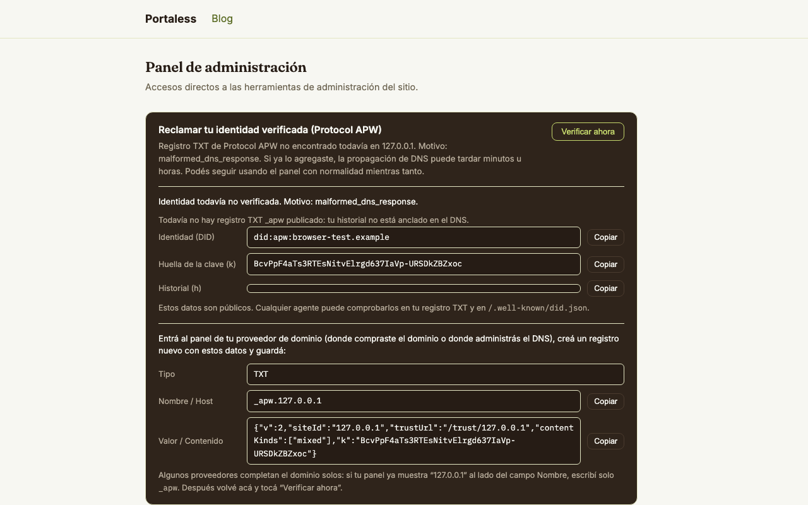
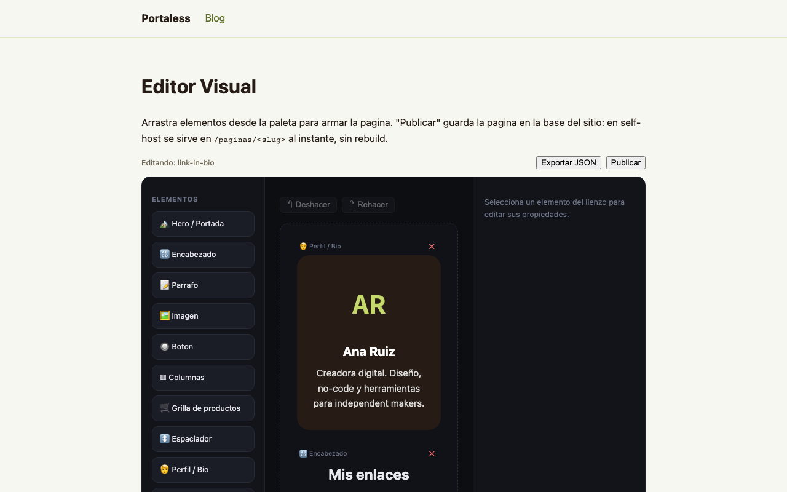
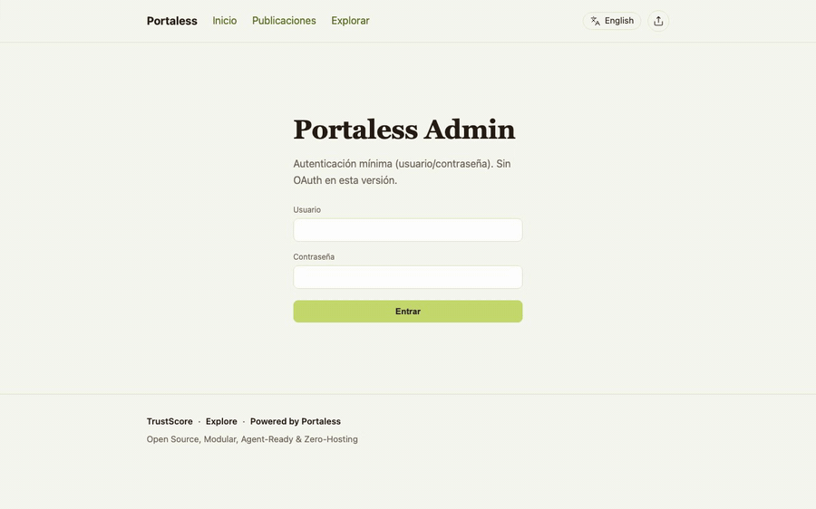

# Instalá tu sitio en 10 minutos

Guía para vos, no para un programador. Si sabés usar Docker y un navegador,
llegás hasta el final. No hace falta terminal más allá de un único comando,
ni saber TypeScript, ni tocar la base de datos.

Al terminar vas a tener **un sitio publicado con tu identidad
criptográfica propia** (Protocol APW), editable desde el navegador.

**Lo que necesitás**: [Docker Desktop](https://www.docker.com/products/docker-desktop/)
instalado y abierto. Nada más.

---

## Paso 1 — Levantá Portaless (1 minuto)

Abrí una terminal y pegá este comando en la carpeta donde descargaste el
proyecto:

```bash
docker compose up -d
```

Esperá unos segundos. Si Docker te pide permiso, aceptalo. Portaless ya
está corriendo en tu computadora.

## Paso 2 — Creá tu cuenta de administrador (2 minutos)

1. Abrí [http://localhost:4321/setup](http://localhost:4321/setup) en tu navegador.
2. Necesitás el **código de configuración**. Mirá los logs con:
   `docker compose logs portaless` — buscá el bloque `CODIGO DE
   CONFIGURACION` (también queda en `/data/SETUP_CODE.txt` dentro del
   volumen).
3. Pegá el código, elegí tu usuario y una contraseña de **12 caracteres
   como mínimo**. El código vence en 60 minutos; si se agota, reiniciá el
   contenedor con `docker compose restart` para generar uno nuevo.

> **Importante**: si generaste una clave de cifrado (Paso 5), guardala en
> un lugar seguro. Sin ella nadie —ni vos— puede descifrar la identidad
> del sitio.

Listo: entrás a [http://localhost:4321/admin](http://localhost:4321/admin)
con tu usuario y contraseña.

## Paso 3 — El asistente de 3 pasos (3 minutos)



En el panel vas a ver el asistente. Contale al asistente **qué es tu
sitio** (nombre, dominio si tenés, y si es un portafolio, una tienda, un
blog o una página para difundir algo). Con eso solo, Portaless te arma un
borrador de página con elementos ya colocados.

Después el asistente te lleva a **generar la identidad de tu sitio**: un
par de claves criptográficas y un registro DNS (el `_apw`) que prueba que
el dominio es tuyo. El panel te muestra **exactamente el texto y el valor
que tenés que pegar** en el DNS de tu proveedor de dominio (Namecheap,
Cloudflare, donde lo hayas comprado), con botones de copiar. Cuando lo
pegues, volvé al panel y tocá **“Verificar ahora”**.

Esa identidad es lo que hace que tu sitio sea *verificable* por
cualquiera (humanos o agentes de IA) sin depender de ninguna empresa
intermediaria: es Protocol APW, un protocolo abierto.

## Paso 4 — Armá y publicá una página (2 minutos)



1. Andá a **Editor Visual** desde el panel.
2. Arrastrá elementos desde la paleta izquierda: títulos, botones,
   videos, preguntas frecuentes, formularios de contacto, galerías… son
   17 elementos y todos se editan tocando el elemento y cambiando lo que
   ves a la derecha.
3. Cuando esté como querés, tocá **Publicar**. Aparece un link
   “Ver página pública ↗”: tocálo y tu página está viva.



**Lo que ves en la demo pública es real**: este mismo motor de elementos
es el que usa el sitio de ejemplo
([https://geroiloyola.github.io/portaless/](https://geroiloyola.github.io/portaless/)).

## Paso 5 — Elegí los colores (1 minuto)

En **Apariencia** elegís un skin (catálogo, portafolio, lanzamiento…)
o cambiás el color de acento a mano. El cambio se refleja en el panel,
en el editor y en la página publicada, todo desde el mismo lugar.

## Paso 6 — Poné tu sitio en internet (opcional, hoy con un límite honesto)

Hasta acá todo funciona **en tu computadora**. Para que el mundo lo vea:

- **GitHub Pages** (gratis): el asistente conecta tu cuenta de GitHub.
  Hoy publicar requiere un último paso en terminal
  (`npm run publish`) — es el paso menos amigable del producto y está
  en la lista de mejoras del Beta. La guía completa:
  [`docs/DEPLOY_GITHUB_PAGES.md`](./DEPLOY_GITHUB_PAGES.md).
- **Cloudflare Pages / self-host**: el panel y las páginas dinámicas
  funcionan completos (no solo el sitio estático). Guía:
  [`docs/DEPLOY_CLOUDFLARE_PAGES.md`](./DEPLOY_CLOUDFLARE_PAGES.md) y
  [`docs/self-hosting.md`](./self-hosting.md).

---

## Qué está listo y qué no (sin adornos)

**Listo hoy**: editor visual con 17 elementos y publicación desde el
navegador; identidad criptográfica `did:apw` con rotación de claves;
SiteTrustScore público; testigos y Portaless Index (agregador de
observaciones verificadas); 6 skins; sitio demo público con capturas
reales.

**No está listo hoy**: el paso final de publicación en GitHub Pages
todavía usa terminal; la conexión OAuth a Cloudflare Pages está
“próximamente” en el asistente; este Beta lo mantiene **una sola
persona** (la decisión de sumar un segundo mantenedor está documentada
en `SECURITY.md`); y todavía no hay ni una persona fuera del proyecto
que haya instalado Portaless sin ayuda del autor — ese es justamente el
criterio de salida del Beta, y hasta que no pase, “Beta” es el nombre
honesto de esta etapa, no un número de versión.

**Más info**: el estado real por módulo vive en
[`ROADMAP.md`](../ROADMAP.md); la demo pública, arriba; el protocolo
abierto detrás de todo esto, en [`docs/protocol-apw/`](./protocol-apw/).
